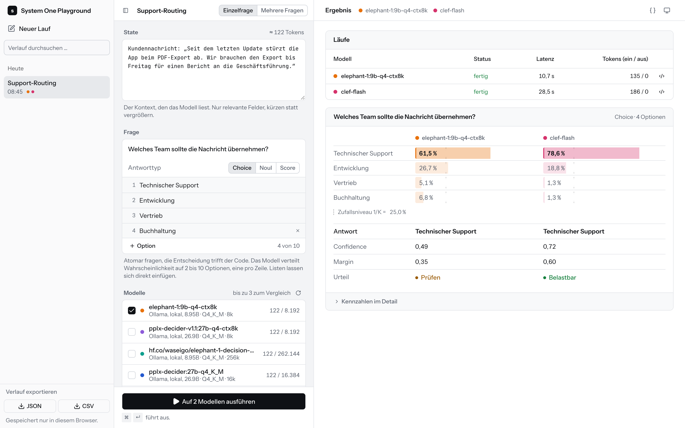

<div align="center">

# System One Playground

**Ask atomic questions, compare System One models side by side, see how sure they are.**

[](https://github.com/dasultras/systemone-playground/actions/workflows/ci.yml)
[](https://github.com/dasultras/systemone-playground/pkgs/container/systemone-playground)
[](LICENSE)
<br>
[](https://nextjs.org)
[](https://nodejs.org)
[](https://www.typescriptlang.org)
[](https://ollama.com)

<picture>
  <source media="(prefers-color-scheme: dark)" srcset="docs/screenshot-dark.png">
  
</picture>

</div>

## Features

- **Choice, Noul, Score**: probability distributions instead of free text, with confidence, margin, entropy and a
  traffic-light verdict.
- **Compare** up to three models in one run: TypeSafe Jev (hosted), Ollama or vLLM (local).
- **Any System One model**: auto-detected from Ollama (`decision` capability) and vLLM, known models can be pulled
  from the UI.
- **Order averaging** against position bias, **request inspector** with the raw payload.
- **History** in the browser with JSON/CSV export, presets as a mountable JSON file.
- **Evaluation script**: Brier, NLL, ECE, risk-coverage and bootstrap CIs on synthetic items.

> [!IMPORTANT]
> Use TypeSafe with **synthetic data only** (hosted in the US). Local models never leave your machine.

## Quick start

```bash
docker compose up                                # published image from ghcr.io → http://localhost:3000
docker compose -f compose.dev.yml up --build     # build the image locally
```

Ollama runs natively on the host (GPU/Metal), the container reaches it via `host.docker.internal:11434`. Health check:
`GET /api/health`.

<details>
<summary><b>Development</b></summary>

```bash
cp .env.example .env    # requires Node 24 and Ollama
npm ci
npm run dev             # → http://localhost:3000
```

`npm run check` (types, OxLint, Prettier) · `npm run fix` · `npm test` · [Dev Container](.devcontainer/devcontainer.json)
for VS Code. AI agents: see [AGENTS.md](AGENTS.md).

</details>

## Configuration

Set in `.env` ([`.env.example`](.env.example)) or in [`compose.yml`](compose.yml), read at startup.

| Variable                  | Default                       | Effect                                           |
| ------------------------- | ----------------------------- | ------------------------------------------------ |
| `OLLAMA_BASE_URL`         | `http://localhost:11434`      | Ollama instance, empty disables it               |
| `VLLM_BASE_URL`           | –                             | vLLM instance                                    |
| `TYPESAFE_API_KEY`        | –                             | Enables TypeSafe Jev (hosted)                    |
| `TYPESAFE_DAILY_REQUESTS` | `200`                         | Daily budget for TypeSafe runs                   |
| `DEFAULT_MODEL`           | first Ollama model            | Preselected model, e.g. `ollama:elephant-1:9b-q4-ctx8k` |
| `PRESETS_FILE`            | `config/presets.default.json` | Presets file                                     |
| `ALLOW_PULL`              | –                             | `1` allows pulling known models from the UI      |

<details>
<summary><b>Backends and models</b></summary>

Any server that speaks the System One schema (`/v1/systemone`) works via its base URL:

- **TypeSafe** (`api.typesafe.ai`), hosted
- **[Ollama](https://docs.ollama.com/api/systemone)** (`localhost:11434`), local
- **[vLLM](https://docs.vllm.ai/en/latest/models/structured_decisions_models/#example)** (`localhost:8000`): start with
  `--logprobs-mode raw_logprobs`, max. 64 questions per request, unknown fields return 400.

`GET /api/models` lists the models with a backend prefix (`ollama:`, `vllm:`, `typesafe:`), cached for 30 s.
[`config/models.json`](config/models.json) lists known System One models; those missing in Ollama show up as "nicht
installiert". With `ALLOW_PULL=1` a button pulls them via `POST /api/models/pull` (only listed models, same origin),
otherwise the UI shows `ollama pull <name>` to copy. Pulling uses disk space on the host.

</details>

<details>
<summary><b>Presets</b></summary>

The default [`config/presets.default.json`](config/presets.default.json) holds a single simple question, so the focus
is on your own input. [`examples/presets.example.json`](examples/presets.example.json) shows all question types and a
bundle with a rule. Point `PRESETS_FILE` at your own file, in Docker via the commented volume in `compose.yml`. With two
or more presets the input shows a "Vorlage laden" menu. Files are validated by [`lib/presets.ts`](lib/presets.ts); an
invalid file falls back to the default.

</details>

<details>
<summary><b>Evaluation</b></summary>

```bash
npm run eval -- --limit 2    # smoke run
npm run eval                 # 600 synthetic items, split 200/400, raw and averaged
```

Runs against a running server (`--base-url`, default `:3000`) with `--models` (default
`ollama:elephant-1:9b-q4-ctx8k`). Answers are cached per question in `eval/out/raw/` (resumable), the report lands in
`eval/out/report.md`. `typesafe:` models require `EVAL_ALLOW_TYPESAFE=1`.

</details>

---

<sub>[MIT](LICENSE) · Images for amd64 and arm64 are built by [CI](.github/workflows/ci.yml) on tags `v*.*.*`.</sub>
